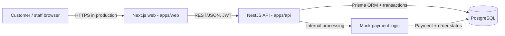

# BrewLite - Architecture Overview (Assignment 2, Task 3.1)

**Owner:** Danh (A2-13)  
**Reviewer:** Khoa  
**Status:** Proposed for Task 3 review; final production hosting details belong to A2-14/A2-15.  
**Baseline:** BrewLite documentation snapshot from 2026-11-05. Confirm file and implementation changes on the latest `origin/main` before merging.

## 1. Purpose and boundaries

BrewLite is a mobile-first coffee ordering application. Its core flow is: browse menu -> select options -> manage cart -> authenticate -> create order -> confirm simulated payment -> track order. The architecture keeps the **Next.js web client**, **NestJS REST API**, and **PostgreSQL** separate while developing and versioning them in one repository. **Prisma** is the API's database access and migration layer.

The MVP supports internally simulated **MOMO** and **CARD** payments. It does **not** collect actual money, call external payment gateways, or process provider webhooks/IPNs. Admin/staff features may share the backend but do not turn the frontend into a trusted source for prices, stock, or authorization.

**Scope of this document:** logical architecture, responsibilities, data flow, operational principles, alternatives and trade-offs. The exact cloud provider, container registry, public URLs, rollback method and deployment topology are to be confirmed by the A2-14 owner and A2-15 reviewer, not invented here.

## 2. Container view

**Repository boundaries:** `apps/web` owns UI and client interaction; `apps/api` owns business rules and API; Prisma schema/migrations define persisted data; `docs` contains SRS, UML and architecture evidence. Docker Compose provides local orchestration for `frontend`, `backend` and `db` as described in `docs/deployment.md`.

| Layer | Responsibility | Explicit non-responsibility |
| --- | --- | --- |
| Next.js web (mobile-first, PWA target) | Menu, product options, cart, login flows, checkout QR/card confirmation, order history, responsive/loading/empty/error states | Does not decide the trusted order total, decrement stock, or set `PAID` directly |
| NestJS REST API | JWT authentication/authorization, products, orders, stock validation, promotions, loyalty calculations, mock payment, status transitions | Does not rely on browser-supplied final prices or payment success flags |
| Prisma + PostgreSQL | Durable users, products, orders/items, payment attempts and domain state; migration history; transactional consistency | Does not implement UI or actual external payment settlement |
| Mock payment logic inside API | Simulates MOMO/CARD result, enforces ownership, idempotency and order transitions | No VNPay/MOMO provider connection, real transfer or provider callback |
| Operational boundary | Runtime configuration, health endpoint, logs and CI/CD checks | Does not store secrets in the repository or expose a production database publicly |

> PWA is an architectural **target** from the assignment; installability, service worker and offline behavior must be checked in code/tests before being claimed as implemented.

## 3. Logical NestJS boundaries

These are **responsibility groups**, not a claim that every name is already an individual `*.module.ts` file:

- **Auth/Users:** registration, bcrypt password hashes, JWT authentication, customer profile and role checks.
- **Products/Catalog:** menu, details, sizes, toppings; inventory-related product and ingredient reads.
- **Orders/Inventory:** server-side pricing, promotion validation, available-ingredient checks, transactional stock adjustment and initial `PENDING` order creation.
- **Payments:** idempotency-key validation/replay, internal MOMO/CARD simulation, atomic payment/order status changes.
- **Promotions/Loyalty:** discounts and points rules; redeem/award only on successful payment, with no duplicate award.
- **Staff/Admin:** protected order operations and product/inventory management, where implemented.

Order status is controlled by the API: `PENDING`, `PAID`, `PAYMENT_FAILED`, `PREPARING`, `READY`, `COMPLETED` and `CANCELLED` are the statuses described by the SRS/domain UML. Valid transitions and role permissions belong to the backend. `LoyaltyTransaction` is conceptual in the domain diagram and is **not** currently a persisted Prisma model in the reviewed snapshot; do not document it as an existing database table.

## 4. Checkout sequence and consistency

1. Web loads customer/cart information; protected actions require a valid JWT. Invalid or expired authentication redirects the user to login without silently placing an order.
2. Web optionally previews promotion and points. API must recompute pricing and validate conditions from server-side data.
3. `POST /orders` validates items and availability, then creates order/items with initial `PENDING` status and adjusts ingredient stock within a DB transaction; an out-of-stock failure rolls back order creation.
4. Web shows `/checkout/qr` (MOMO simulation) or `/checkout/confirm` (CARD simulation), then the **customer confirms**.
5. Web sends `POST /payments` with `Idempotency-Key`; API verifies ownership, order amount/status and replay constraints. Payment runs **inside NestJS**, without a third-party gateway.
6. On success, store `Payment=SUCCESS`, transition order to `PAID`, redeem/award loyalty once, and then the web removes paid items from cart and shows the success page. On failure, store `Payment=FAILED`, transition order to `PAYMENT_FAILED` and preserve the cart.
7. Customers may cancel only their own unpaid online orders (`PENDING` or `PAYMENT_FAILED`). Staff may cancel an unpaid order or a paid order before preparation starts. A successful payment remains recorded; a paid cancellation requires a manual refund outside the application.
8. A cancellation atomically transitions the order, fails any pending payment sessions, and restores the reserved required ingredients once. Payment expiry also cancels the order and restores its reservation.

**Cancellation constraint:** inventory restoration uses the current required recipe for each order item. Paid-order refunds are not automated or verified against a payment provider; staff must handle them manually.

**Route verification:** the checkout specification names `/checkout/success`; verify the current Next.js route before claiming the code uses the same URL.

## 5. Operations, security and deployment constraints

| Concern | Design / verification point |
| --- | --- |
| Local environment | Docker Compose for `frontend`, `backend`, `db`; PostgreSQL persistent volume; backend waits for DB health; Prisma migrations before serving. Check actual Compose behavior before demo. |
| Database changes | Commit `schema.prisma` and migration SQL together; use `prisma migrate deploy` for shared/prod environments; do not reset non-empty databases. |
| Secrets | `.env.example` documents variable names; runtime credentials/JWT secret supplied through private environment or CI secrets. Do not commit `.env`, log JWTs, passwords or payment headers. |
| Access control | bcrypt for stored passwords; JWT and resource ownership/role checks for private APIs; backend computes totals; production HTTPS. |
| Mock payment safety | MOMO/CARD remain internal demo methods. The test-only `simulateFailure` switch should be rejected in production; never imply real money is transferred. |
| Logging | Prefer consistent level, timestamp, route, status, latency, request/correlation ID (when implemented); avoid credentials/PII in logs. **Verify logging implementation** before claiming structured logs are deployed. |
| Health | Expose/probe an API health endpoint (e.g. `GET /health`) and check DB readiness. Verify actual route and live behavior before acceptance. |
| Resilience | Use transactions for stock/order and payment/order/points consistency; idempotency for payment retry; persist DB volumes; define deployment rollback with A2-14/A2-15. |
| CI/CD | PR checks should cover install, lint, tests, builds. Image registry, HTTPS hosting, release/rollback policy and public endpoints depend on actual deployment decisions. |

### PWA and production verification

The assignment requests mobile-first/PWA and a production-accessible HTTPS deployment. These are **acceptance targets**, not evidence of a completed production deployment. Record the real host, registry, service topology and probes after A2-14/A2-15 have selected and verified them.

The [deployment diagram](../diagrams/deployment.svg) separates the verified local/CI setup from production targets that still need a hosting decision. Its editable source is [deployment.puml](../diagrams/deployment.puml).

## 6. Decision trade-offs

| Decision | Benefit | Cost / limitation | Reference |
| --- | --- | --- | --- |
| Monorepo + separate Next.js/NestJS applications | Simple team coordination, consistent docs/CI, independent UI and API boundaries | Changes may affect shared build/CI; one repo does not imply one deployable | [ADR-001](adr/001-monorepo-separate-web-api.md) |
| PostgreSQL + Prisma + migrations | Relational consistency and transaction support for order, stock and payment state | Schema migrations and concurrency handling require care | [ADR-002](adr/002-postgresql-prisma-transactions.md) |
| Internal MOMO/CARD mock payment | Deterministic demo and end-to-end tests without funds or provider credentials | Not evidence of real payment integration or banking-grade settlement | [ADR-003](adr/003-internal-mock-payment.md) |

## 7. Traceability and review checklist

- FR-01 to FR-04: catalog/cart/auth -> Next.js and Auth/Products API.
- FR-05: create order, stock check -> Orders/Inventory and PostgreSQL transaction.
- FR-06, FR-08: mock payment/status/idempotency -> Payments API and PostgreSQL transaction.
- FR-07, FR-09, FR-10: history, promotions, loyalty -> Orders/Promotions/Users API.
- NFR-02, NFR-04: JWT/roles/secrets/HTTPS; Compose, migrations and configuration.
- UML references: `docs/diagrams/activity-checkout.puml`, `sequence-checkout.puml`, `class-domain.puml` and `docs/requirements/use-case-checkout.md`.

**Before Khoa approves A2-13:** confirm the latest GitHub file list/PRs; review logical groups against the current code; confirm the payment simulator and test-only flags; ensure A2-14 can use this architecture without inventing hosting. The baseline SRS snapshot contains conflicting wording about disabling mock payment in production (FR-06.4 vs NFR-02.4); track this inconsistency rather than changing Khoa's SRS as part of A2-13.
