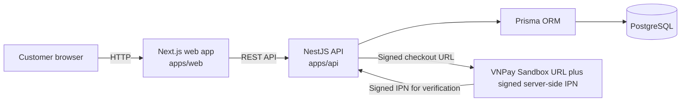

# BrewLite architecture diagram

The browser return from VNPay is not trusted to change `Payment`/`Order` into PAID. Only validated signed IPN can settle a payment. For runtime and the GHCR/Render topology, see [deployment.md](../deployment.md) and [deployment.svg](deployment.svg).
