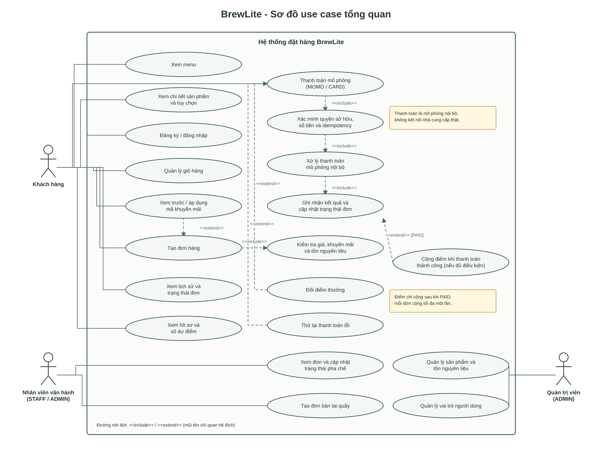

# Đặc tả yêu cầu phần mềm BrewLite (rút gọn)

## Mục đích và phạm vi

BrewLite cho phép khách hàng xem menu đồ uống, tùy chỉnh sản phẩm, quản lý giỏ hàng, áp dụng khuyến mãi, sử dụng điểm thưởng, đặt hàng, thanh toán qua VNPay Sandbox và theo dõi trạng thái đơn. Hệ thống kiểm tra tồn nguyên liệu khi tạo đơn và hỗ trợ nhân viên vận hành cập nhật trạng thái đơn. Hệ thống hiện tại gồm ứng dụng web Next.js, API NestJS và PostgreSQL. Thu tiền thực tế và đối soát với nhà cung cấp vẫn ngoài phạm vi.

## Mức ưu tiên MoSCoW

| Mức ưu tiên | Ý nghĩa |
| --- | --- |
| Must (Bắt buộc) | Cần có để phát hành hệ thống.
| Should (Nên có) | Có thể triển khai sau. |
| Could (Có thể có) | Hữu ích nhưng không chặn phát hành. |
| Won't (Chưa làm trong phiên bản này) | Nằm ngoài phạm vi phiên bản hiện tại. |

Phân bổ ưu tiên trong tài liệu này:

| Mức | Yêu cầu |
| --- | --- |
| Must | FR-01 đến FR-10, NFR-02, NFR-04 |
| Should | NFR-01, NFR-03 |
| Could | Chưa có hạng mục trong baseline; các tính năng bổ sung được đánh giá ở phiên bản sau. |
| Won't | Thu tiền thật và đối soát với nhà cung cấp thanh toán. |

## Yêu cầu chức năng

| Mã | Chức năng | Ưu tiên | Tiêu chí chấp nhận | Kiểm chứng |
| --- | --- | --- | --- | --- |
| FR-01 | Xem menu | Must | **AC-01.1:** Khi `GET /products` trả HTTP `200`, menu hiển thị từng sản phẩm cùng tên và giá. **AC-01.2:** Khi API trả danh sách rỗng, web hiển thị trạng thái menu trống và không hiển thị dữ liệu sản phẩm cũ. | Kiểm thử tích hợp API sản phẩm và luồng end-to-end trên web. |
| FR-02 | Xem chi tiết sản phẩm | Must | **AC-02.1:** Với ID hợp lệ, trang chi tiết hiển thị đúng tên, giá và tùy chọn do API cung cấp. **AC-02.2:** Với ID không tồn tại, API trả HTTP `404` và web hiển thị trạng thái không tìm thấy. **AC-02.3:** Chỉ size/topping được cung cấp cho sản phẩm mới có thể chọn để thêm vào giỏ. | API sản phẩm unit/integration test và web end-to-end cho ID hợp lệ, không hợp lệ. |
| FR-03 | Quản lý giỏ hàng | Must | **AC-03.1:** Mặt hàng khác sản phẩm, size hoặc topping hiển thị thành dòng riêng; thêm lại cùng cấu hình tăng số lượng đúng 1. **AC-03.2:** Đổi số lượng cập nhật tổng theo công thức tổng `đơn giá × số lượng`; đặt số lượng bằng 0 xóa dòng hàng. **AC-03.3:** Sau khi tải lại trang, các mặt hàng còn trong giỏ được khôi phục; xóa một dòng không làm thay đổi dòng khác. | Unit test store giỏ hàng và web end-to-end cho thêm/sửa/xóa/tải lại. |
| FR-04 | Đăng ký và đăng nhập | Must | **AC-04.1:** Đăng ký loại bỏ khoảng trắng thừa trong tên, chuẩn hóa email; email chuẩn hóa bị trùng trả HTTP `409`. **AC-04.2:** Thông tin hợp lệ trả access token; thông tin sai trả HTTP `401` mà không tiết lộ email có tồn tại hay không. **AC-04.3:** Endpoint được bảo vệ từ chối yêu cầu thiếu JWT hoặc JWT không hợp lệ bằng HTTP `401`. | HTTP/unit test xác thực và luồng end-to-end trên web. |
| FR-05 | Tạo đơn hàng | Must | **AC-05.1:** Đơn hợp lệ được lưu cùng các dòng hàng, tổng tiền do server tính và trạng thái đầu `PENDING`. **AC-05.2:** Đơn không có mặt hàng hợp lệ bị từ chối bằng phản hồi 4xx và không tạo bản ghi. **AC-05.3:** Sửa giá/tổng tiền trong request không làm thay đổi số tiền được lưu; server tính tiền từ dữ liệu phía server. | Orders HTTP/integration test, kiểm tra dữ liệu đã lưu và web end-to-end checkout. |
| FR-06 | Thanh toán VNPay Sandbox | Must | **AC-06.1:** Yêu cầu có idempotency key tối đa 128 ký tự; thiếu hoặc sai key trả HTTP `400`. **AC-06.2:** Số tiền request khác số tiền server tính bị từ chối bằng HTTP `400`. **AC-06.3:** Gửi lại cùng request với cùng key trả kết quả cũ và không tạo bản ghi thanh toán thứ hai. **AC-06.4:** Chỉ VNPay IPN có chữ ký, mã giao dịch và số tiền hợp lệ mới cập nhật trạng thái; session quá hạn chuyển đơn sang `CANCELLED`. | HTTP/unit/integration test cho intent, chữ ký callback, replay và expiry. |
| FR-07 | Xem lịch sử đơn hàng | Must | **AC-07.1:** Lịch sử chỉ trả đơn của người dùng hiện tại; không thể đọc đơn người khác (HTTP `403` hoặc `404` theo hợp đồng API). **AC-07.2:** Mỗi dòng hiển thị mã đơn, ngày tạo, tổng tiền, trạng thái; chi tiết hiển thị mặt hàng và thông tin xác nhận từ API. **AC-07.3:** Sau thanh toán hoặc cập nhật trạng thái, tải lại lịch sử hiển thị trạng thái mới nhất từ API. | Orders HTTP/integration test quyền sở hữu và web end-to-end tạo đơn, xem lịch sử, mở chi tiết. |
| FR-08 | Quản lý trạng thái đơn hàng | Must | **AC-08.1:** Chỉ cho phép `PENDING -> PAID`, `PAYMENT_FAILED` hoặc `CANCELLED`; `PAYMENT_FAILED -> PENDING` hoặc `CANCELLED`; `PAID -> PREPARING` hoặc `CANCELLED`; `PREPARING -> READY`; `READY -> COMPLETED`. **AC-08.2:** `COMPLETED` và `CANCELLED` là trạng thái cuối; chuyển trạng thái sai trả HTTP `409` và giữ nguyên trạng thái. **AC-08.3:** Với hai cập nhật đồng thời từ cùng trạng thái, tối đa một cập nhật thành công; cập nhật xung đột trả HTTP `409`. **AC-08.4:** Người dùng không có quyền vận hành không thể đưa đơn sang `PREPARING`, `READY` hoặc `COMPLETED`; API từ chối yêu cầu. | Unit test state machine, integration test đồng thời và kiểm thử quyền trên API cập nhật trạng thái. |
| FR-09 | Xem trước và áp dụng khuyến mãi | Must | **AC-09.1:** Với mã khuyến mãi hợp lệ và giỏ hàng đủ điều kiện, hệ thống trả về mã đã chuẩn hóa, tiền giảm và tổng sau giảm được tính từ giá phía server. **AC-09.2:** Mã không hợp lệ, hết hạn hoặc không đạt điều kiện bị từ chối; không áp dụng giảm giá và khách vẫn có thể đặt hàng không dùng mã. **AC-09.3:** Khi tạo đơn, server kiểm tra lại mã và tự tính khoản giảm; không tin khoản giảm hoặc tổng tiền do client gửi. | Orders/promotion HTTP và integration test cho mã hợp lệ, không hợp lệ, điều kiện áp dụng và tạo đơn. |
| FR-10 | Xem và sử dụng điểm thưởng | Must | **AC-10.1:** Khách đã đăng nhập xem được số dư điểm của tài khoản mình. **AC-10.2:** Khi checkout, khách có thể dùng số điểm nguyên không vượt số dư hoặc giá trị đơn; mỗi điểm đổi giảm `1.000` VND. **AC-10.3:** Điểm chỉ bị trừ khi thanh toán thành công; số dư không đủ làm giao dịch thất bại mà không ghi nhận khoản trừ. **AC-10.4:** Sau thanh toán thành công, khách nhận 1 điểm cho mỗi `10.000` VND đã thanh toán; một đơn không được cộng thưởng lặp lại. | Kiểm thử profile, payment HTTP/integration và giao dịch đồng thời cho redeem/award điểm. |

## Yêu cầu phi chức năng

| Mã | Thuộc tính | Ưu tiên | Tiêu chí chấp nhận | Kiểm chứng |
| --- | --- | --- | --- | --- |
| NFR-01 | Hiệu năng; mục tiêu đề xuất cần PO/ops phê duyệt | Should | **AC-NFR-01.1:** Trong kiểm thử tải 10 phút với 100 người dùng ảo đồng thời, p95 của `GET /products` và truy vấn lịch sử đơn <= 2 giây; p95 của tạo đơn và thanh toán <= 3 giây; tỷ lệ HTTP 5xx < 1%. **AC-NFR-01.2:** Báo cáo ghi build/commit, môi trường, bộ dữ liệu, mức tải, p50/p95/p99 và tỷ lệ lỗi; không dùng kết quả local để công bố hiệu năng production. | Chạy lại bài kiểm thử tải trên môi trường đã thống nhất; lưu báo cáo kết quả. |
| NFR-02 | Bảo mật | Must | **AC-NFR-02.1:** Mật khẩu lưu dưới dạng bcrypt hash, không xuất hiện trong phản hồi API hoặc log. **AC-NFR-02.2:** Endpoint được bảo vệ yêu cầu JWT hợp lệ và kiểm tra quyền sở hữu; người chưa xác thực và người dùng truy cập đơn/thanh toán của người khác đều bị từ chối trong kiểm thử âm tự động. **AC-NFR-02.3:** Server tự tính số tiền; provider secrets chỉ đọc từ môi trường; callback chữ ký sai không được thay đổi dữ liệu. | Kiểm thử xác thực/ủy quyền/thanh toán và rà soát cấu hình production. |
| NFR-03 | Khả dụng và phục hồi; mục tiêu đề xuất cần ops phê duyệt | Should | **AC-NFR-03.1:** Khả dụng production đề xuất >= 99.5% mỗi tháng, đo bằng health probe bên ngoài ít nhất mỗi phút; báo cáo riêng bảo trì có kế hoạch. **AC-NFR-03.2:** Sau khi restart riêng backend hoặc frontend, dịch vụ healthy trong <= 5 phút; restart database không làm mất dữ liệu đã commit khi giữ persistent volume. | Báo cáo probe tháng và kiểm thử restart/lưu bền dữ liệu bằng Docker Compose; smoke test Compose không được coi là bằng chứng SLA production. |
| NFR-04 | Triển khai và migration bằng Compose | Must | **AC-NFR-04.1:** Từ checkout sạch với biến môi trường hợp lệ, `docker compose up --build` khởi chạy PostgreSQL, API, web; API chờ DB healthy, chạy migration và vượt health check trước khi web khởi động. **AC-NFR-04.2:** Stack healthy trong <= 5 phút trên máy CI/máy phát triển đã thống nhất; web và API truy cập được tại URL/port cấu hình. **AC-NFR-04.3:** Chạy seed lại không tạo bản ghi trùng; restart dịch vụ giữ dữ liệu PostgreSQL đã commit khi named volume còn tồn tại. **AC-NFR-04.4:** Production dùng credential/secret không mặc định và không bật mô phỏng thanh toán dành cho development. | Smoke test triển khai Compose, kiểm thử seed lặp lại, restart/lưu bền dữ liệu và rà soát cấu hình production. |

## Tài liệu tham chiếu

- Use case chi tiết checkout: [use-case-checkout.md](use-case-checkout.md).
- Sơ đồ use case tổng quan: [usecase-overview.svg](../diagrams/usecase-overview.svg); nguồn chỉnh sửa: [usecase-overview.puml](../diagrams/usecase-overview.puml).

## Sơ đồ use case tổng quan của hệ thống

