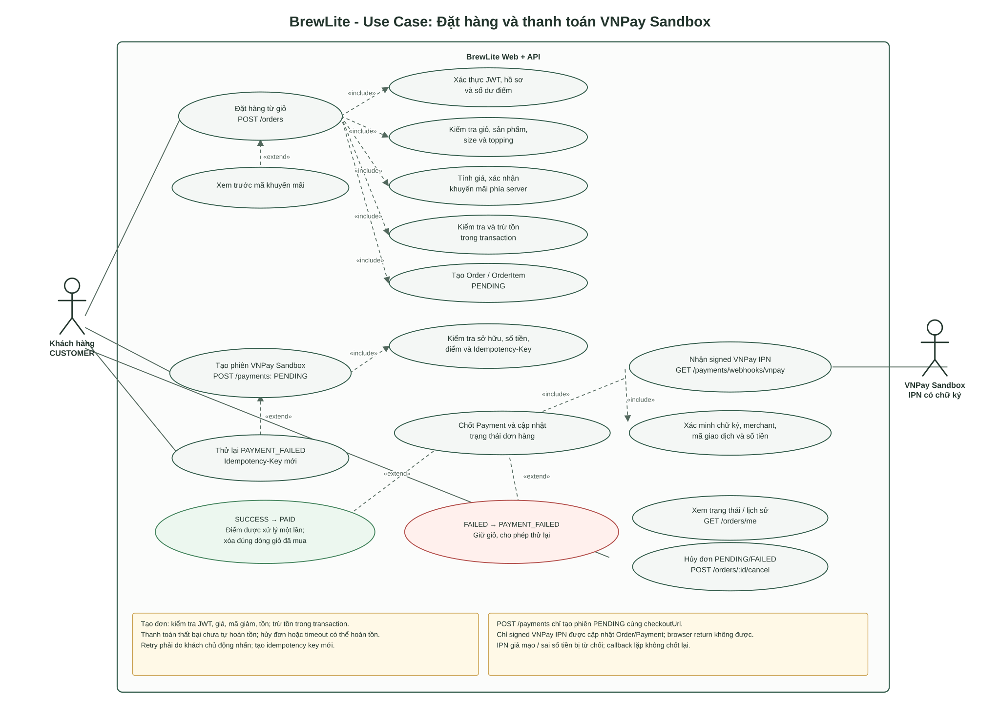

# Đặc tả Use Case: Đặt hàng & Thanh toán (Checkout)

## 1. Thông tin Use Case
* **Use Case ID:** UC-CHECKOUT
* **Use Case Name:** Đặt hàng và Thanh toán
* **Actor chính:** Khách hàng (`CUSTOMER`); nếu chưa đăng nhập, người dùng phải xác thực trước khi tạo đơn. **Actor liên quan:** VNPay Sandbox gửi IPN.
* **Trigger:** Khách hàng chọn thanh toán từ giỏ hàng, xác nhận đơn ở `/checkout` rồi chuyển sang `/checkout/qr`.
* **Mức độ ưu tiên:** Must (Bắt buộc) - Tham chiếu `FR-05`, `FR-06`, `FR-08`.

## Sơ đồ Use Case chi tiết

Nguồn chỉnh sửa: [usecase-checkout.puml](../diagrams/usecase-checkout.puml). Sơ đồ cập nhật A2-05 mô tả phiên thanh toán `PENDING`, IPN có chữ ký, nhánh thành công/thất bại, thử lại và hủy đơn; tự hết hạn phiên được giải thích tại mục 5.8.

---

## 2. Tiền điều kiện (Pre-conditions)
1. Trước khi gọi `POST /orders`, khách có JWT hợp lệ, vai trò `CUSTOMER`; nếu chưa đăng nhập, UI đưa tới `/login?next=%2Fcheckout` và sau khi xác thực quay lại checkout.
2. Giỏ có ít nhất một dòng được chọn để thanh toán; sản phẩm, số lượng, size và topping hợp lệ.
3. PostgreSQL có dữ liệu sản phẩm và công thức. Backend **kiểm tra lại tồn kho và tính tổng tiền trong transaction** khi tạo đơn, không tin giá hoặc số lượng tồn từ client.

---

## 3. Hậu điều kiện (Post-conditions)
* **Thành công:**
  1. Bản ghi `Order` được tạo với trạng thái `PENDING`, sau đó chuyển thành `PAID` khi thanh toán hoàn tất.
  2. Bản ghi `Payment` được tạo với `status = SUCCESS`, gắn với `idempotencyKey` tương ứng.
  3. Điểm thưởng sử dụng (nếu có) bị trừ khỏi tài khoản; điểm thưởng tích lũy mới được cộng vào user sau khi đơn chuyển `PAID`.
  4. Frontend chỉ xóa **các dòng giỏ đã mua**, không xóa các món khác vẫn để trong giỏ.
  5. UI điều hướng đến `/checkout/success?orderId=...`; khách có thể theo dõi tại `/orders`.
* **Thanh toán thất bại:**
  1. IPN thất bại hợp lệ đưa `Payment` về `FAILED` và `Order` về `PAYMENT_FAILED`; không trừ điểm đổi hoặc cộng điểm mới.
  2. Giữ nguyên giỏ; người dùng có thể **chủ động thử lại** trên cùng đơn với idempotency key mới. Tồn kho đã trừ khi tạo đơn **không tự hoàn chỉ vì trạng thái `PAYMENT_FAILED`**.
* **Hết hạn hoặc hủy:**
  1. Payment PENDING hết hạn được xử lý thành FAILED; đơn còn được phép hủy chuyển sang `CANCELLED` và được hoàn tồn nguyên liệu trong transaction.
  2. Tại `/orders`, khách có thể hủy đơn ONLINE ở trạng thái `PENDING` hoặc `PAYMENT_FAILED` qua `POST /orders/:id/cancel`. Đơn đã `CANCELLED` không thể thanh toán lại.

---

## 4. Luồng sự kiện chính (Main Flow)

| Bước | Tác nhân (Actor) | Phản hồi của Hệ thống (System) | Mapping FR/NFR |
| :---: | :--- | :--- | :--- |
| **1** | Khách vào `/checkout` từ giỏ hàng. | Frontend kiểm tra token, chuyển `/login?next=%2Fcheckout` nếu thiếu; khi hợp lệ, gọi `GET /users/me` và hiển thị giỏ, điểm, tổng tiền, phương thức VNPay. | `FR-03`, `FR-04`, `NFR-02` |
| **2** | *(Tùy chọn)* Khách nhập mã khuyến mãi (VD: `GIAM10`) và nhấn "Áp dụng". | Hệ thống gửi `POST /orders/promotion-preview`, kiểm tra điều kiện áp dụng, trả về số tiền được giảm (`discountAmount`) và cập nhật lại tổng tiền thanh toán hiển thị. | `FR-09` |
| **3** | *(Tùy chọn)* Khách tick chọn "Dùng điểm cho đơn này" và nhập số điểm muốn đổi. | Hệ thống quy đổi điểm (1 điểm = 1.000đ, tối đa không vượt quá tổng đơn) và tính lại số tiền thanh toán cuối cùng. | Task 10 / Loyalty |
| **4** | Khách chọn VNPay Sandbox và nhấn nút xác nhận đặt hàng. | Hệ thống kiểm tra tính hợp lệ của giỏ hàng, điểm thưởng và mã giảm giá ở Client trước khi gọi API. | `FR-05` |
| **5** | Frontend gửi request `POST /orders` tạo đơn hàng. | Hệ thống tạo bản ghi `Order` với trạng thái ban đầu là `PENDING`, lưu trữ danh sách `OrderItem`, tự tính lại tổng tiền từ Database. | `FR-05`, `AC-05.1` |
| **6** | Giao diện chuyển sang `/checkout/qr`. | UI gọi `GET /orders/:id`, sinh/lấy lại UUID trong `Idempotency-Key`, gửi `POST /payments` với VNPAY và điểm quy đổi. API tạo phiên `Payment PENDING` với `expiresAt`/`checkoutUrl` và trả QR/link, **chưa chốt PAID**. | `FR-06`, `FR-10`, `AC-06.1`, `AC-06.3` |
| **7** | Khách mở VNPay Sandbox và thực hiện giao dịch. | Browser return không quyết định kết quả. `GET /payments/webhooks/vnpay` xác thực chữ ký, merchant, mã giao dịch và số tiền; IPN hợp lệ mới cập nhật `Payment SUCCESS/FAILED` và `Order PAID/PAYMENT_FAILED` (hoặc `CANCELLED` nếu đã hết hạn). | `FR-06`, `FR-08`, `AC-06.4` |
| **8** | Khách chờ xác nhận trên trang QR. | UI poll `GET /orders/:id` mỗi 3 giây; khi trạng thái đã thanh toán, chỉ xóa các dòng giỏ của đơn đó và chuyển `/checkout/success?orderId=...`. | `FR-03`, `FR-07`, `FR-08` |
| **9** | Khách xem lịch sử đơn. | `GET /orders/me` cho phép xem trạng thái và chi tiết đơn đúng quyền sở hữu, kể cả thanh toán thất bại hoặc đã hủy. | `FR-07`, `AC-07.1`, `AC-07.3` |

---

## 5. Các luồng phụ & Ngoại lệ (Alternative & Exception Flows)

### 5.1. Ngoại lệ 1: Khách hàng chưa đăng nhập hoặc Token hết hạn (Unauthenticated)
* **Tại Bước 1:** Không có token (`!getAccessToken()`), token hết hạn hoặc không đủ quyền.
* **Xử lý:** Trường hợp thiếu token, UI chuyển `/login?next=%2Fcheckout`; trang đăng nhập/đăng ký chỉ cho quay lại các đường dẫn `next` nội bộ được phép. API kiểm tra JWT, role và từ chối bằng 401/403 nếu sai.
* **Kết quả:** Đăng nhập/đăng ký thành công quay lại `/checkout` với giỏ còn nguyên; xác thực thất bại không tạo đơn.
* **Mapping:** `FR-04` (AC-04.3), `NFR-02`.

### 5.2. Ngoại lệ 2: Giỏ hàng trống khi truy cập Checkout
* **Tại Bước 1 hoặc 4:** Danh sách món `items.length === 0`.
* **Xử lý:** Hiển thị màn hình thông báo: "Giỏ hàng của bạn đang trống" cùng nút điều hướng "Khám phá thực đơn" (`/`). Khóa không cho thực hiện thao tác thanh toán.
* **Mapping:** `FR-03`, `FR-05` (AC-05.2).

### 5.3. Ngoại lệ 3: Mã giảm giá không hợp lệ hoặc hết hạn
* **Tại Bước 2:** Khách hàng nhập mã không tồn tại, hết hạn hoặc không đủ giá trị đơn tối thiểu (`minOrderTotal`).
* **Xử lý:** API trả lỗi 4xx. Giao diện hiển thị cảnh báo màu đỏ (`promotionError`), không áp dụng giảm giá. Khách cần xóa mã không hợp lệ khỏi ô nhập rồi mới tiếp tục thanh toán với giá gốc.
* **Mapping:** Task 10 Promotion Validation.

### 5.4. Ngoại lệ 4: Điểm thưởng sử dụng không hợp lệ
* **Tại Bước 3:** Số điểm nhập là số âm, số thập phân hoặc vượt quá `maxRedeemable` (số điểm hiện có hoặc vượt quá giá trị đơn hàng).
* **Xử lý:** Giao diện chặn thanh toán và hiển thị thông báo lỗi: *"Số điểm sử dụng không hợp lệ hoặc vượt số điểm hiện có."*
* **Mapping:** Task 10 Loyalty System.

### 5.5. Ngoại lệ 5: Hết hàng / Không đủ tồn kho (Out of Stock / Concurrency Conflict)
* **Tại Bước 5:** Khi server tạo đơn, số lượng nguyên liệu trong bảng `Ingredient` không đủ đáp ứng.
* **Xử lý:** Server từ chối tạo đơn trong transaction và trả lỗi 4xx; transaction rollback, không tạo Order, frontend giữ giỏ. Khi tạo Order thành công, nguyên liệu đã được trừ; bước thanh toán không trừ thêm tồn kho.
* **Mapping:** `FR-05`, `CV18` (Optimistic locking).

### 5.6. Ngoại lệ 6: Thanh toán thất bại (Payment Failed)
* **Tại Bước 7:** Giao dịch mô phỏng trả về thất bại.
* **Xử lý:**
  1. Trạng thái bản ghi `Payment` ghi nhận `FAILED`.
  2. Trạng thái bản ghi `Order` chuyển sang `PAYMENT_FAILED`.
  3. **Frontend giữ các món trong giỏ**, không xóa các món chưa mua thành công.
  4. Trang `/checkout/qr` có nút **"Thử thanh toán lại"**. Chỉ khi khách nhấn nút mới tạo `Idempotency-Key` mới và phiên VNPay mới cho **cùng Order**; đơn có thể chuyển `PAYMENT_FAILED -> PENDING`.
  5. Không tự hoàn tồn khi chỉ ở `PAYMENT_FAILED`. Khi hủy đơn hoặc hết hạn phiên PENDING, quy trình hủy hoàn tồn nguyên liệu. UI hiện tại **không** hỗ trợ chuyển phương thức khác ngoài VNPay.
* **Mapping:** `FR-06`, `FR-08` (AC-08.1), `CV19`.

### 5.7. Ngoại lệ 7: Khách hàng gửi lặp request thanh toán (Replay Request / Network Lag)
* **Tại Bước 6 & 7:** Khách hàng nhấn nút thanh toán nhiều lần liên tục hoặc mạng bị lặp gói tin.
* **Xử lý:** Cùng `Idempotency-Key` và payload trả Payment cũ, không tạo trùng. Dùng lại key với dữ liệu không tương thích sẽ bị từ chối. Nếu một phiên `PENDING` phù hợp đang mở, key mới cũng có thể tái sử dụng phiên đang hoạt động. Retry sau `PAYMENT_FAILED` chỉ bắt đầu khi người dùng chủ động nhấn nút với key mới.
* **Mapping:** `FR-06` (AC-06.1, AC-06.3), `NFR-02`.

### 5.8. Ngoại lệ 8: Hết hạn QR và hủy đơn (Expired / Cancelled)
* **Hết hạn:** `Payment.expiresAt` dựa trên `PAYMENT_TTL_MINUTES` (mặc định 15 phút). `PaymentsService` chạy bộ quét `expirePendingPayments()` khi khởi động và mỗi 15 giây; IPN đến trễ cũng xử lý là hết hạn. Payment PENDING chuyển FAILED; Order còn được phép hủy chuyển `CANCELLED` và hoàn tồn nguyên liệu trong transaction hủy.
* **Hủy chủ động:** Khách vào `/orders` nhấn **"Hủy đơn"** nếu trạng thái `PENDING` hoặc `PAYMENT_FAILED`; UI gọi `POST /orders/:id/cancel`. API kiểm tra JWT, sở hữu đơn ONLINE và trạng thái hợp lệ trước khi hủy.
* **Sau hủy:** `CANCELLED` là trạng thái cuối, không thể trả tiền lại; phải tạo đơn mới. Browser return không được dùng để hủy hoặc xác nhận đã thanh toán.
* **Mapping:** `FR-06` (AC-06.4), `FR-08` (AC-08.1, AC-08.2), `NFR-02`.

---

## 6. Lưu ý về cơ chế cập nhật trạng thái qua bên thứ ba (VNPay Sandbox / Webhook)
* Hệ thống tuân thủ nguyên tắc không để Client tự ý chuyển trạng thái đơn sang `PAID`.
* VNPay sandbox IPN nhận tại `GET /payments/webhooks/vnpay`.
* Callback phải có chữ ký hợp lệ và khớp mã merchant, giao dịch, số tiền, trạng thái thanh toán và thời hạn. Browser return không được quyền cập nhật đơn hàng.
* `POST /payments` chỉ tạo phiên thanh toán `PENDING` có `checkoutUrl`/`expiresAt`, chưa xác nhận thu tiền; browser return không tự chuyển `PAID`.
* QR/session có hạn theo `PAYMENT_TTL_MINUTES` (mặc định 15 phút); bộ quét mỗi 15 giây hoặc IPN muộn xử lý hết hạn và hủy đơn đủ điều kiện, hoàn tồn kho.
* Một Payment chỉ được chốt một lần; callback lặp không được trừ/cộng điểm hoặc cập nhật đơn lần thứ hai. Thanh toán thất bại có thể được thử lại chủ động với key mới.

---

## 7. Bảng ánh xạ Yêu cầu Chức năng (Mapping FR)

| Mã FR | Tên yêu cầu chức năng trong SRS | Điểm chạm trong Use Case Checkout |
| :--- | :--- | :--- |
| **FR-03** | Quản lý giỏ hàng | Lấy danh sách `items`, phân tách dòng theo `itemKey`, giữ nguyên giỏ khi lỗi và xóa giỏ khi thanh toán thành công. |
| **FR-04** | Đăng ký và đăng nhập | JWT và role `CUSTOMER`; `/login?next=%2Fcheckout` để khách quay lại sau khi xác thực. |
| **FR-05** | Tạo đơn hàng | Gửi payload tạo đơn `POST /orders`, server tính lại toàn bộ tiền độc lập từ CSDL và lưu trạng thái ban đầu `PENDING`. |
| **FR-06** | Thanh toán VNPay Sandbox | Tạo Payment `PENDING` với key, có thời hạn; chỉ signed IPN được cập nhật kết quả, chống replay và xử lý hết hạn. |
| **FR-07** | Xem lịch sử đơn hàng | Tra cứu `GET /orders/me` và `GET /orders/:id` theo quyền sở hữu, phản ánh trạng thái mới nhất. |
| **FR-08** | Quản lý trạng thái đơn hàng | `PENDING -> PAID/PAYMENT_FAILED/CANCELLED`; `PAYMENT_FAILED -> PENDING` khi chủ động retry hoặc `-> CANCELLED` khi hủy; `CANCELLED` là trạng thái cuối. |
| **FR-09** | Khuyến mãi | `POST /orders/promotion-preview`; server xác nhận lại mã và tiền giảm khi `POST /orders`. |
| **FR-10** | Điểm thưởng | Quy đổi 1 điểm = 1.000 VND; chỉ trừ điểm và cộng điểm mới sau IPN thành công, không cộng lặp. |

---

## 8. Kiểm thử tham chiếu cho tiêu chí chấp nhận

| Hành vi | Test liên quan |
| :--- | :--- |
| Tạo Order PENDING, rollback khi thiếu nguyên liệu, không bán vượt tồn | `apps/api/src/orders/orders.http.spec.ts`, `apps/api/src/orders/orders.concurrency.int.spec.ts` |
| Chỉ IPN hợp lệ mới chốt PAID, từ chối chữ ký sai, hết hạn và auto-cancel | `apps/api/src/payments/payments.service.spec.ts` |
| Cùng idempotency key không tạo thanh toán trùng | `apps/api/src/payments/payments.idempotency.int.spec.ts` |
| Khách hủy đơn đúng trạng thái, có hoàn tồn | `apps/api/src/orders/order-cancellation.spec.ts`, `apps/api/src/orders/orders.cancellation.http.spec.ts` |
| Luồng menu → tạo đơn → signed IPN mô phỏng → lịch sử PAID | `tests/e2e/checkout-vnpay-paid.e2e-spec.ts` |

**Giới hạn:** Các test IPN nói trên dùng chữ ký mô phỏng local. Chúng không thay thế minh chứng giao dịch thực tế trên trang VNPay Sandbox hosted hoặc xác nhận production. Những minh chứng đó thuộc Task 5.
