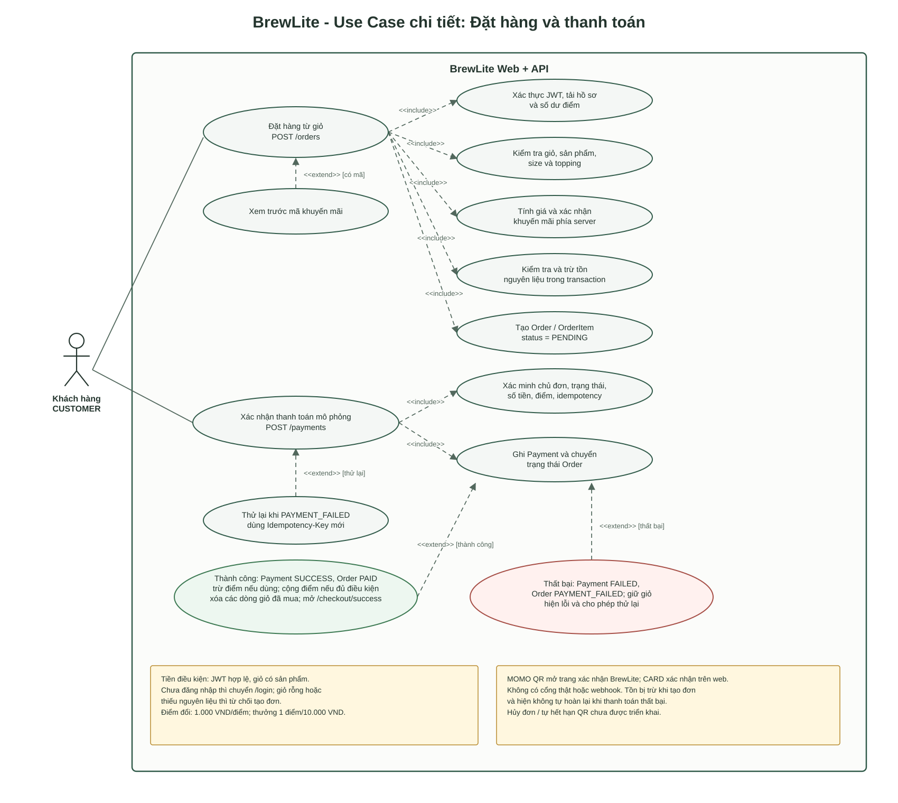

# Đặc tả Use Case: Đặt hàng & Thanh toán (Checkout)

## 1. Thông tin Use Case
* **Use Case ID:** UC-CHECKOUT
* **Use Case Name:** Đặt hàng và Thanh toán
* **Actor:** Khách hàng (User đã đăng nhập hợp lệ với vai trò `CUSTOMER`)
* **Trigger:** Khách hàng nhấn nút "Tiến hành thanh toán" từ màn hình giỏ hàng hoặc nhấn nút "Tiếp tục đến mã QR" / "Xem lại đơn & xác nhận" tại trang `/checkout`.
* **Mức độ ưu tiên:** Must (Bắt buộc) - Tham chiếu `FR-05`, `FR-06`, `FR-08`.

## Sơ đồ Use Case chi tiết

Nguồn chỉnh sửa: [usecase-checkout.puml](../diagrams/usecase-checkout.puml). Sơ đồ mô tả luồng đang triển khai; hủy đơn và tự hết hạn QR chưa có trong luồng checkout hiện tại.

---

## 2. Tiền điều kiện (Pre-conditions)
1. Khách hàng đã đăng nhập tài khoản hợp lệ vào hệ thống (tồn tại JWT Access Token trong cookie/storage).
2. Giỏ hàng có ít nhất 1 sản phẩm hợp lệ (`items.length > 0`).
3. Sản phẩm và nguyên vật liệu pha chế tương ứng còn tồn kho khả dụng trong CSDL.

---

## 3. Hậu điều kiện (Post-conditions)
* **Thành công:**
  1. Bản ghi `Order` được tạo với trạng thái `PENDING`, sau đó chuyển thành `PAID` khi thanh toán hoàn tất.
  2. Bản ghi `Payment` được tạo với `status = SUCCESS`, gắn với `idempotencyKey` tương ứng.
  3. Điểm thưởng sử dụng (nếu có) bị trừ khỏi tài khoản; điểm thưởng tích lũy mới được cộng vào user sau khi đơn chuyển `PAID`.
  4. Các mặt hàng thanh toán thành công được loại bỏ khỏi giỏ hàng phía Frontend.
  5. Khách hàng được chuyển hướng đến màn hình xác nhận đơn (`/checkout/success`).
* **Thất bại / Hủy:**
  1. Khi thanh toán thất bại, bản ghi đơn chuyển sang `PAYMENT_FAILED`; hủy đơn không thuộc luồng checkout hiện tại.
  2. Giỏ hàng của khách hàng được giữ nguyên để có thể thử lại. Lưu ý: tồn nguyên liệu đã bị trừ khi tạo đơn và hiện không tự hoàn lại khi thanh toán thất bại.

---

## 4. Luồng sự kiện chính (Main Flow)

| Bước | Tác nhân (Actor) | Phản hồi của Hệ thống (System) | Mapping FR/NFR |
| :---: | :--- | :--- | :--- |
| **1** | Khách hàng mở trang `/checkout`. | Hệ thống kiểm tra JWT. Nếu hợp lệ, tải thông tin điểm thưởng (`fetchMyProfile`), hiển thị danh sách món đã chọn, đơn giá, tổng tạm tính và các lựa chọn thanh toán. | `FR-04`, `NFR-02` |
| **2** | *(Tùy chọn)* Khách nhập mã khuyến mãi (VD: `GIAM10`) và nhấn "Áp dụng". | Hệ thống gửi `POST /orders/promotion-preview`, kiểm tra điều kiện áp dụng, trả về số tiền được giảm (`discountAmount`) và cập nhật lại tổng tiền thanh toán hiển thị. | `FR-09` |
| **3** | *(Tùy chọn)* Khách tick chọn "Dùng điểm cho đơn này" và nhập số điểm muốn đổi. | Hệ thống quy đổi điểm (1 điểm = 1.000đ, tối đa không vượt quá tổng đơn) và tính lại số tiền thanh toán cuối cùng. | Task 10 / Loyalty |
| **4** | Khách chọn phương thức thanh toán (`MOMO` hoặc `CARD`) và nhấn nút xác nhận đặt hàng. | Client kiểm tra dữ liệu để phản hồi sớm; server vẫn tự kiểm tra giỏ, mã khuyến mãi, tồn kho và tính lại giá khi tạo đơn. | `FR-05` |
| **5** | Frontend gửi request `POST /orders` tạo đơn hàng. | Hệ thống tạo bản ghi `Order` với trạng thái ban đầu là `PENDING`, lưu trữ danh sách `OrderItem`, tự tính lại tổng tiền từ Database. | `FR-05`, `AC-05.1` |
| **6** | Hệ thống chuyển hướng khách hàng sang màn hình xác nhận (`/checkout/qr` đối với MOMO hoặc `/checkout/confirm` đối với CARD). | MOMO hiển thị QR dẫn tới trang xác nhận BrewLite; CARD xác nhận ngay trên web. Khi xác nhận, frontend gửi `POST /payments` với UUID `Idempotency-Key`. | `FR-06`, `AC-06.1` |
| **7** | Khách hàng xác nhận thanh toán mô phỏng. | Backend kiểm tra quyền sở hữu đơn, trạng thái, số tiền sau khi đổi điểm và `Idempotency-Key`; sau đó ghi `Payment` và chuyển `PENDING` sang `PAID` hoặc `PAYMENT_FAILED`. Không gọi cổng thanh toán hay callback bên ngoài. | `FR-06`, `FR-08`, `AC-08.1` |
| **8** | Hệ thống trả về kết quả thanh toán thành công. | Backend trừ điểm đã đổi (nếu có) và cộng điểm tích lũy một lần nếu đủ điều kiện. Frontend xóa các dòng giỏ thuộc đơn rồi chuyển đến `/checkout/success` hiển thị mã đơn. | `FR-03`, `FR-07`, `FR-10` |

---

## 5. Các luồng phụ & Ngoại lệ (Alternative & Exception Flows)

### 5.1. Ngoại lệ 1: Khách hàng chưa đăng nhập hoặc Token hết hạn (Unauthenticated)
* **Tại Bước 1:** Frontend kiểm tra không tìm thấy token đăng nhập (`!getAccessToken()`).
* **Xử lý:** Hệ thống tự động chuyển hướng khách hàng về trang đăng nhập: `router.push('/login?redirect=/checkout')`.
* **Kết quả:** Sau khi đăng nhập thành công, khách được đưa trở lại trang checkout với giỏ hàng nguyên vẹn.
* **Mapping:** `FR-04` (AC-04.3), `NFR-02`.

### 5.2. Ngoại lệ 2: Giỏ hàng trống khi truy cập Checkout
* **Tại Bước 1 hoặc 4:** Danh sách món `items.length === 0`.
* **Xử lý:** Hiển thị màn hình thông báo: "Giỏ hàng của bạn đang trống" cùng nút điều hướng "Khám phá thực đơn" (`/`). Khóa không cho thực hiện thao tác thanh toán.
* **Mapping:** `FR-03`, `FR-05` (AC-05.2).

### 5.3. Ngoại lệ 3: Mã giảm giá không hợp lệ hoặc hết hạn
* **Tại Bước 2:** Khách hàng nhập mã không tồn tại, hết hạn hoặc không đủ giá trị đơn tối thiểu (`minOrderTotal`).
* **Xử lý:** API trả lỗi 4xx. Giao diện hiển thị cảnh báo màu đỏ (`promotionError`), không áp dụng giảm giá. Khách cần xóa mã không hợp lệ khỏi ô nhập rồi mới tiếp tục thanh toán với giá gốc.
* **Mapping:** Task 10 Promotion Validation.

### 5.4. Ngoại lệ 4: Điểm thưởng sử dụng không hợp lệ
* **Tại Bước 3:** Số điểm nhập là số âm, số thập phân hoặc vượt quá `maxRedeemable` (số điểm hiện có hoặc vượt quá giá trị đơn hàng).
* **Xử lý:** Giao diện chặn thanh toán và hiển thị thông báo lỗi: *"Số điểm sử dụng không hợp lệ hoặc vượt số điểm hiện có."*
* **Mapping:** Task 10 Loyalty System.

### 5.5. Ngoại lệ 5: Hết hàng / Không đủ tồn kho (Out of Stock / Concurrency Conflict)
* **Tại Bước 5:** Khi server tạo đơn, số lượng nguyên liệu trong bảng `Ingredient` không đủ đáp ứng.
* **Xử lý:** Server từ chối tạo đơn trong transaction và trả lỗi 4xx; frontend hiển thị thông báo lỗi, giỏ hàng được giữ nguyên và không có đơn mới. Kiểm tra tồn kho không diễn ra lần nữa tại bước thanh toán.
* **Mapping:** `FR-05`, `CV18` (Optimistic locking).

### 5.6. Ngoại lệ 6: Thanh toán thất bại (Payment Failed)
* **Tại Bước 7:** Giao dịch mô phỏng trả về thất bại.
* **Xử lý:**
  1. Trạng thái bản ghi `Payment` ghi nhận `FAILED`.
  2. Trạng thái bản ghi `Order` chuyển sang `PAYMENT_FAILED`.
  3. **Frontend giữ nguyên giỏ hàng**, không gọi `clearCart()`.
  4. Hiển thị thông báo: *"Thanh toán thất bại. Vui lòng kiểm tra lại phương thức thanh toán."* kèm nút cho phép đổi sang phương thức khác để thử lại.
  5. Tồn nguyên liệu đã trừ lúc tạo đơn và không được hoàn tự động trong luồng hiện tại.
* **Mapping:** `FR-06`, `FR-08` (AC-08.1), `CV19`.

### 5.7. Ngoại lệ 7: Khách hàng gửi lặp request thanh toán (Replay Request / Network Lag)
* **Tại Bước 6 & 7:** Khách hàng nhấn nút thanh toán nhiều lần liên tục hoặc mạng bị lặp gói tin.
* **Xử lý:** Nhờ header `Idempotency-Key`, Backend kiểm tra khóa đã tồn tại trong bảng `Payment`. Hệ thống trả về ngay kết quả của lần xử lý trước đó mà không trừ tiền/tạo giao dịch lần 2.
* **Mapping:** `FR-06` (AC-06.1, AC-06.3), `NFR-02`.

### 5.8. Ngoài luồng hiện tại: Hủy đơn và hết hạn QR
State machine có trạng thái `CANCELLED`, nhưng checkout hiện chưa cung cấp thao tác hủy cho khách/nhân viên hoặc job tự động hết hạn QR. Vì vậy các trường hợp này không thuộc luồng được mô tả bởi use case và sơ đồ hiện tại.
* **Mapping:** `FR-08` (AC-08.1).

---

## 6. Phạm vi thanh toán
* `MOMO` và `CARD` hiện là lựa chọn mô phỏng nội bộ. QR dẫn tới trang xác nhận của BrewLite; hệ thống không chuyển tiền thật, không gọi nhà cung cấp thanh toán và không nhận webhook/IPN.
* Client không tự đặt trạng thái `PAID`; backend ghi nhận kết quả mô phỏng và cập nhật trạng thái đơn trong transaction.
* Tích hợp nhà cung cấp thật và xác thực webhook/IPN là hướng mở rộng, không thuộc use case hiện hành.

---

## 7. Bảng ánh xạ Yêu cầu Chức năng (Mapping FR)

| Mã FR | Tên yêu cầu chức năng trong SRS | Điểm chạm trong Use Case Checkout |
| :--- | :--- | :--- |
| **FR-03** | Quản lý giỏ hàng | Lấy danh sách `items`, phân tách dòng theo `itemKey`, giữ nguyên giỏ khi lỗi và xóa giỏ khi thanh toán thành công. |
| **FR-04** | Đăng ký và đăng nhập | Kiểm tra trạng thái đăng nhập (JWT Guard) trước khi cho phép vào giao diện thanh toán. |
| **FR-05** | Tạo đơn hàng | Gửi payload tạo đơn `POST /orders`, server tính lại toàn bộ tiền độc lập từ CSDL và lưu trạng thái ban đầu `PENDING`. |
| **FR-06** | Mô phỏng thanh toán | Gửi `Idempotency-Key` UUID, chọn phương thức MOMO/CARD, xử lý mô phỏng kết quả thành công/thất bại. |
| **FR-07** | Xem lịch sử đơn hàng | Sau khi thanh toán hoàn tất, đơn hàng xuất hiện trong danh sách đơn của người dùng (`GET /orders/me`). |
| **FR-08** | Quản lý trạng thái đơn hàng | Checkout chuyển `PENDING` $\to$ `PAID` khi mô phỏng thành công hoặc `PENDING` $\to$ `PAYMENT_FAILED` khi mô phỏng thất bại; retry đưa đơn về `PENDING` trước lần thanh toán mới. Hủy là transition của state machine nhưng chưa có thao tác trong checkout. |